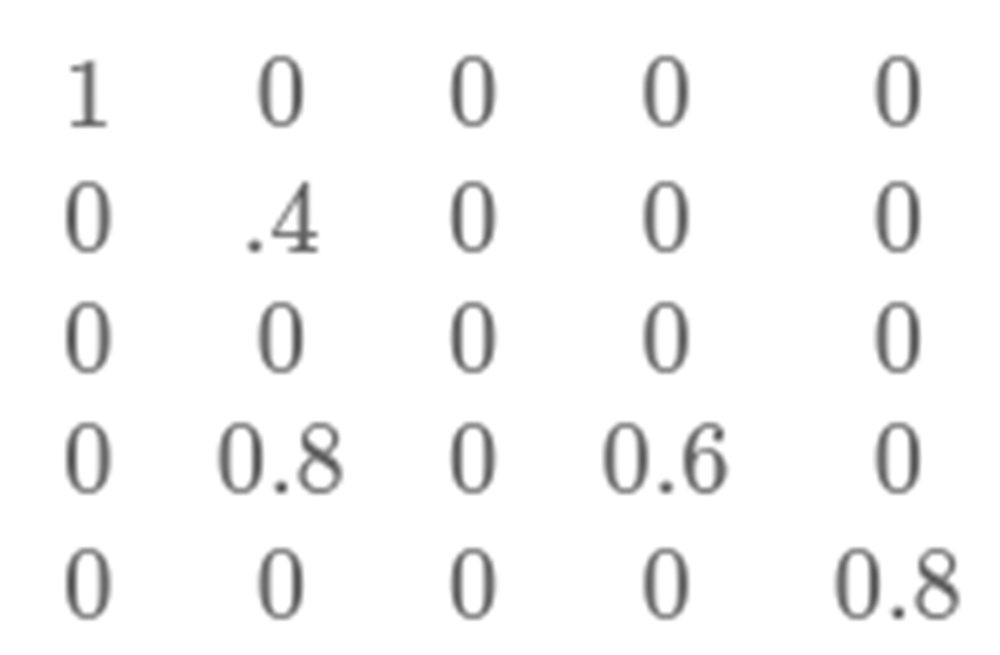
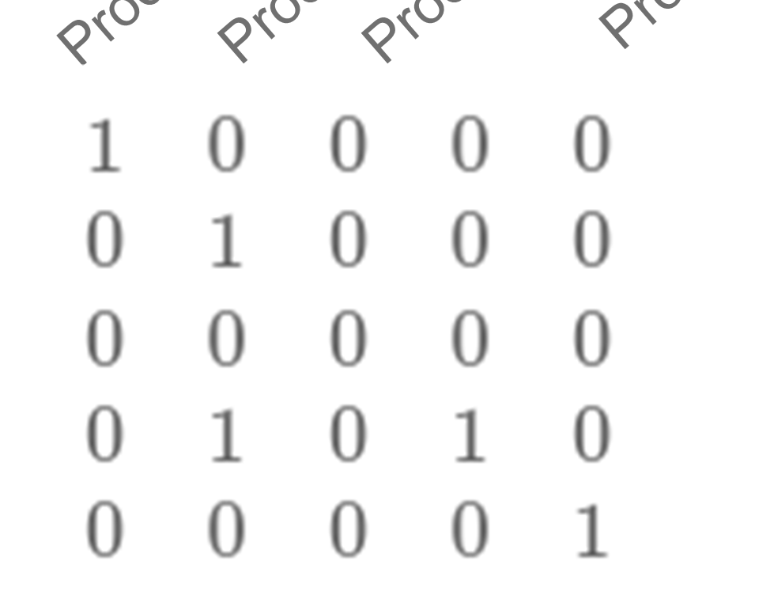
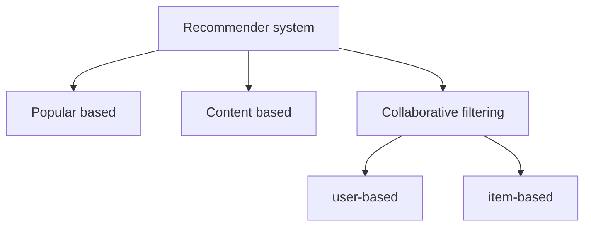
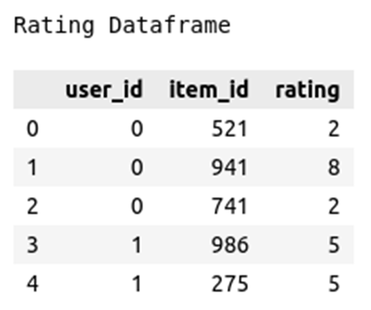
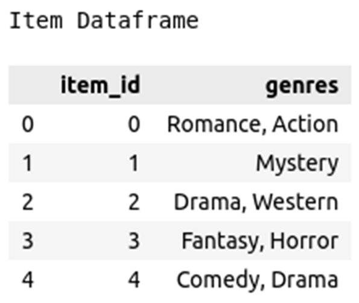
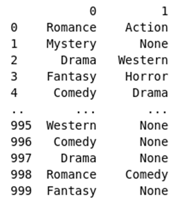
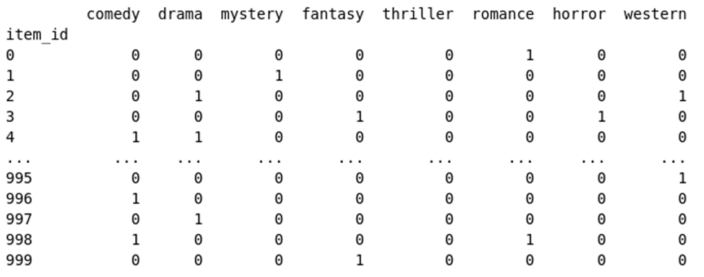
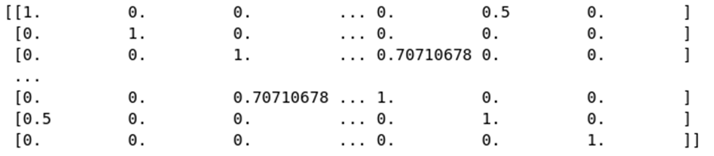
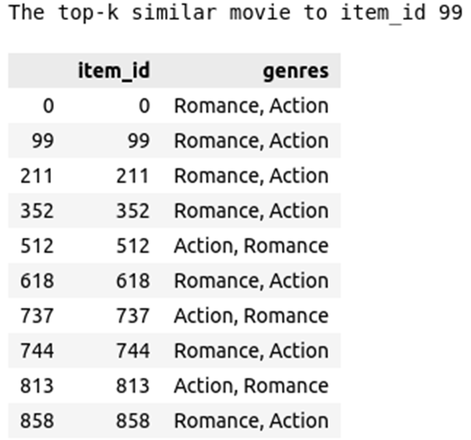
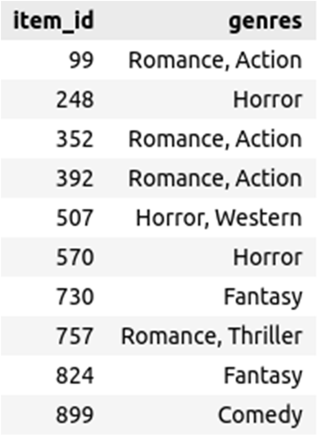

<!-- _class: title-slide -->

# Week 8
## Recommender systems

---

<!-- _class: red-bg -->V
# Herhalen

---

## Vorige week: KMeans & unsupervised learning

- **KMeans** ontdekt zelf **clusters** in data zonder labels (*unsupervised learning*)
- Toepassing destijds: **customer segmentation**, bv. de aanbevolen films van Netflix
- Dat is precies het onderwerp van vandaag: **recommender systems**

> 📌 We blijven werken **zonder labels**: het systeem ontdekt zelf patronen uit het gedrag van users

---

<!-- _class: red-bg -->
# Introductie

---

## Recommender systems overal

- Ze zijn **overal** op het internet te vinden
- Welke bedrijven gebruiken recommender systemen?

---

## Welke bedrijven gebruiken RS?

- **Overal** op het internet: van streaming tot e-commerce
- Bv. **Netflix**, **YouTube**, **Amazon**, **Spotify** & nog veel meer

   

> 💡 Ze raden allemaal **nieuwe content** aan op basis van **jouw (kijk)gedrag**

---

## Wat doet een recommender system?

- Een RS biedt op basis van **vorig gedrag** goede, **nieuwe keuzes** aan
- **Essentieel** voor streaming- en abonnementsplatformen


> 📌 Vandaag: het klassieke voorbeeld — **voorkeur voor films**

---

<!-- _class: red-bg -->
# Notatie

---

## Gebruikte notatie

- **Users**: $u$
- **Producten**: $i, j, \dots$
- **Ratings**: $r$
- Rating van user $u$ over film $i$: $r_{u,i}$
- Bv. de rating van **Bruno over MI6**: $r_{Bruno,Mission Impossible 6}$

---

## Feedback

- Een RS werkt enkel dankzij **feedback** over de aangeboden producten
- **Expliciet**: likes, reviews, sterren, ...
  - hoge kwaliteit, maar **niet overal beschikbaar**
- **Impliciet**: bezochte producten, aangeklikte maar nog niet gespeelde films, ...
  - lage kwaliteit, maar **in grote mate verkrijgbaar**

---

## Feedback stimuleren

- Dit is de reden waarom je een **kortingscode** kunt krijgen of winnen door een **review** te schrijven

---

## Ratingsmatrix: expliciete versie

- Feedback steken we in een **matrix R**
- Bevat typisch waarden tussen **0 en 1**
- Zo niet: eerst **normaliseren**



*Rijen: users (User 1, User 2, ..., User n)*

---

## Ratingsmatrix: impliciete versie

- Feedback steken we in een **matrix R**
- Bevat enkel waarden **0 en 1**



*Rijen: users (User 1, User 2, ..., User n)*

---

<!-- _class: red-bg -->
# Strategieën voor een RS

---

## Drie strategieën



---

## Strategie 1: popular based

- Gebaseerd op **algemene patronen**, niet op een individuele user
- Bv. 'meest bekeken in België deze week'
- Dit is **geen ML**: je kunt het rechtstreeks met **standaard SQL**
- Voor een **nieuwe user zonder voorkennis** is dit het **meest zinvolle**

---

## Popular based: democode

- We doen iets **geavanceerder** dan gewoon 'beste film' of meest gekeken
- De code vind je terug in de notebook

[DEMO] Notebook: `recommender_system_lesversie.ipynb`

---

## Strategie 2: content based

- Op basis van een **bekeken film** stel je films voor met **gelijkaardige features**
- Bv. zelfde regisseur of zelfde genre
- **Nadeel**: één goede film van een genre → plots een hoop films van dat genre
- Iedereen die die film ziet, krijgt **dezelfde suggesties**

---

## Strategie 3: collaborative filtering

- Twee varianten van hetzelfde systeem, **sterk gebaseerd op de ratingmatrix**
  - **user-based**: zoek vergelijkbare users
  - **item-based**: zoek gelijkaardige items
- Die bespreken we in de slides die volgen

---

<!-- _class: red-bg -->
# Content based

---

## Use case: 'Netflix light'

- We bouwen een eigen **film recommendation system**
- We hebben een lijst met users, items (= films) en voor sommige een rating
- Dit in de vorm van **2 dataframes**





[DEMO] Notebook: `recommender_system_lesversie.ipynb`

---

## Stap 1: genres uittrekken

- We coderen de info over een user in een **profile-vector**
- Eerst de **genres als aparte kolommen** uittrekken
- **Genres lowercase en zonder spaties**, dit vermijdt fouten zoals *Fantasy* ≠ *fantasy*

```python
genre = rated_items['genres'].str.split(",", expand=True)
print(genre)

# verzamel alle genres
all_genre = set()
for c in genre.columns:
    distinct_genre = genre[c].str.lower().str.strip().unique()
    all_genre.update(distinct_genre)
all_genre.remove(None)
print(all_genre)
```



---

## Stap 2: user-interactie matrix

- We puzzelen de **user-interactie matrix** in mekaar uit de dataframes
- We kopiëren de relevante kolommen en zetten genres om naar lowercase

```python
item_genre_mat = rated_items[[ITEM_COL, 'genres']].copy()
print(item_genre_mat.head())
item_genre_mat['genres'] = item_genre_mat['genres'].str.lower().str.strip()
```

---

## Stap 3: genres one-hot encoden

- Genres zijn **categorisch** → one-hot encoden (per genre een 1/0-kolom)
- De 'old skool' manier:

```python
for genre in all_genre:
    item_genre_mat[genre] = np.where(
        item_genre_mat['genres'].str.contains(genre), 1, 0)
item_genre_mat = item_genre_mat.drop(['genres'], axis=1)
item_genre_mat = item_genre_mat.set_index(ITEM_COL)
print(item_genre_mat)
```



---

## Stap 4: films vergelijken

- We laten een **similariteitsfunctie** los op de lijst van films
- **Diagonaal is 1**: elke film is similair met zichzelf
- **Symmetrisch**: similariteit tussen $i$ en $j$ is die tussen $j$ en $i$

```python
from sklearn.metrics.pairwise import cosine_similarity
corr_mat = cosine_similarity(item_genre_mat)
print(corr_mat.shape)
print(corr_mat)
```



---

## Cosine similarity

- Berekent per koppel van 2 rijen het **inproduct** gedeeld door de **normen**
- Resultaat: een **getal tussen 0 en 1** (1 = zeer gelijkaardig)

> 💡 Cosine similarity = de **hoek tussen 2 vectoren**; de eenvoudigste metriek die we hier gebruiken

- Er bestaan ook andere metrieken: **Pearson correlatie**, **LDA** & geavanceerdere opties

---

## Stap 5: beste aanbeveling maken

- Neem de rij van een **geziene film**
- Zoek de **kolommen met de grootste waarde**
- Die kolomnamen = films **het meest verwant** met deze film
- Een mooie **oefening in Python en NumPy**

---

## Content based: pseudocode voor het labo

- Gegeven een film: neem de **rij** uit de matrix
- Zoek de **kolommen met de grootste waarde**
- Geef die **kolomnamen** terug: het zijn de meest verwante films



[DEMO] In te vullen tijdens het labo

---

<!-- _class: red-bg -->
# Collaborative filtering

---

## Memory based: uitgangspunt

- We starten met een **memory-based**, gebruikersgebaseerde methode
- Vind een **groep vergelijkbare users** (groepsgrootte willekeurig) op basis van de metriek
- Bereken het **gemiddelde** van de beoordeling per item binnen die groep
- Rangschik op **aflopend gemiddelde**
- Beveel aan wat de doeluser **nog nooit** zag

---

## Memory based: ijle matrix

- We initialiseren een **ijle matrix**, een matrix met heel veel nullen
- Ter info: **0.35%** van de matrix is niet 0, dus 99.65% nullen

```python
from scipy.sparse import csr_matrix
mat = csr_matrix((data, (row, col)), shape=(NUM_USERS, NUM_ITEMS))
mat.eliminate_zeros()
print(mat)
```

- Enkel de **niet-nul items** worden aangeduid, véél efficiënter dan de hele matrix bijhouden

---

## Memory based: matrix transponeren

- Rijen = **users**, kolommen = **items** (anders dan bij content based)
- Similariteit tussen items vraagt **items als rijen** → **transponeren** met `mat.T`
- Daarna passen we de **similariteitsfunctie** toe

```python
item_corr_mat = cosine_similarity(mat.T)   # (1000 items, 1000 items)
```



---

## Memory based: niet schaalbaar

- Wat als er een **nieuwe user** komt?
- De **hele matrix** moet herberekend worden, voor **alle users**
- Dat is **niet schaalbaar**
- Op de duur past zelfs een **ijle matrix** niet meer in memory

---

## Model based met Truncated SVD

- Hier komt **machine learning** van pas
- We maken de **grote matrices kleiner** met **Truncated SVD**
- Truncated SVD ≈ **PCA** (dimensie-reductietechniek)

---

## Model based: item-matrix opstellen

- De kolommen = resultaat van **dimensiereductie** op de users

```python
from sklearn.decomposition import TruncatedSVD
epsilon = 1e-9        # tegen numerieke instabiliteit bij SVD
n_latent_factors = 10 # aantal dimensies dat je wil overhouden
item_svd = TruncatedSVD(n_components=n_latent_factors)
item_features = item_svd.fit_transform(mat.transpose()) + epsilon
item_corr_mat = cosine_similarity(item_features)
```

---

## Model based: ook een limiet

- Ook dit bereikt uiteindelijk een **limiet**
- In de oefeningen kijken we naar **andere libraries**

---

<!-- _class: red-bg -->
# Nadelen van recommender systems

---

## Break: nadelen en tunnelvisie

- Je kunt al snel in een soort **tunnelvisie** terechtkomen
- Laat ons dat eens **testen** op YouTube

> 💡 Een gevaarlijk voorbeeld van hoe goedbedoelde technologie **fake news** in de hand kan werken

---

<!-- _class: red-bg -->
# Samenvatten

---

## Best practices (Week 8)

- **Normaliseer** de ratingsmatrix naar [0,1] of gebruik impliciete 0/1-feedback
- Gebruik **sparse matrices** (`csr_matrix`): ratingsmatrices zijn **99%+ nullen**
- Zet genres eerst naar **lowercase / zonder spaties** vóór one-hot encoding
- Nieuwe user zonder historiek (cold start)? Val terug op **popular based**
- Wees bewust van **tunnelvisie** en de **fake-newsrisico's** van aanbevelingsalgoritmes

---

## Kernpunten

- Strategieën: **popular based** (geen ML), **content based** (features), **collaborative filtering** (ratingmatrix)
- Content based: **one-hot genres** + **cosine similarity**
- Collaborative: user-item matrix **transponeren** + **cosine similarity**
- Memory based schaalt niet → **model based** met **TruncatedSVD** (≈ PCA)

---

## Vragen?
