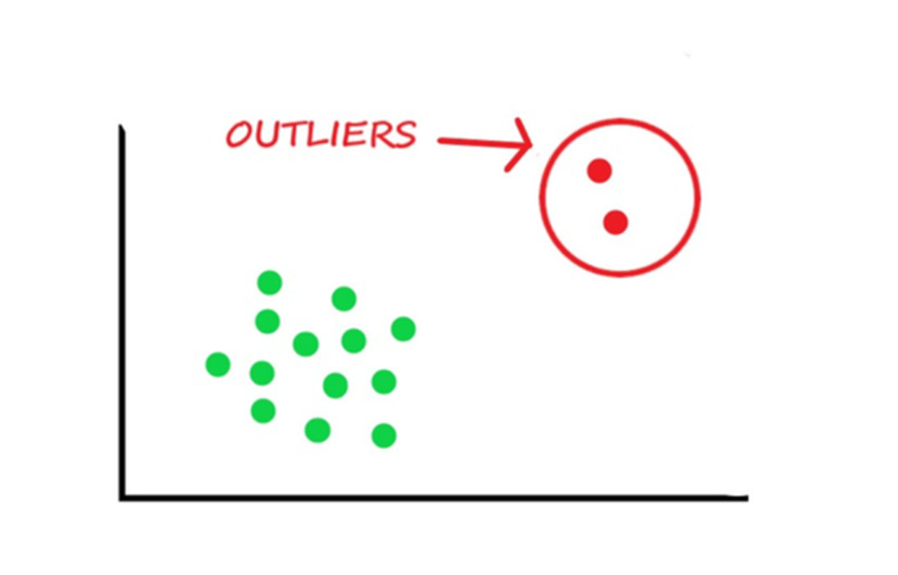
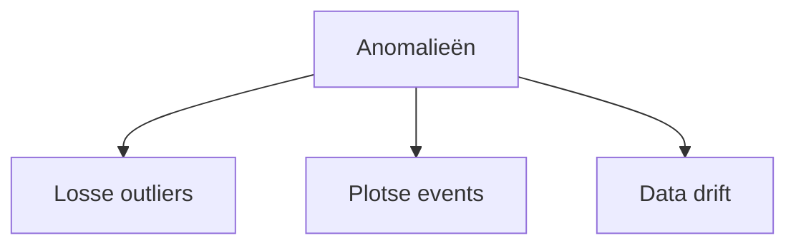
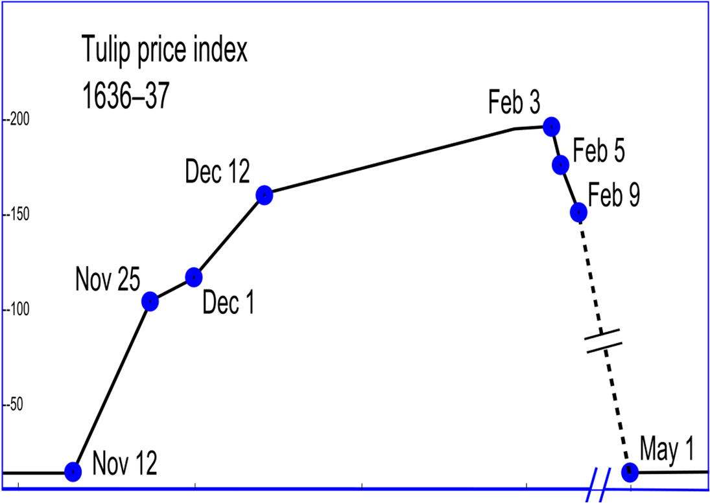
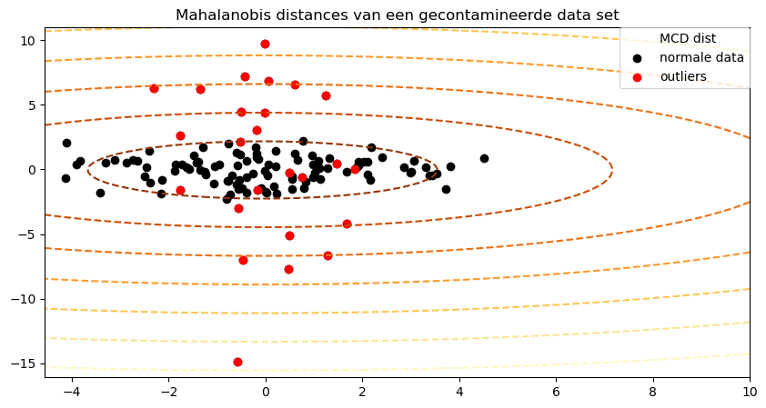
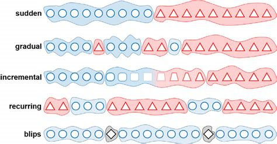
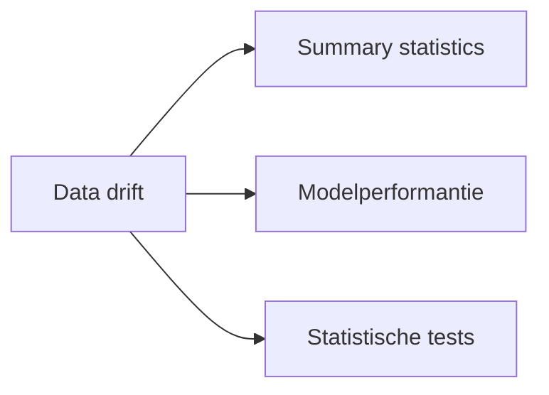
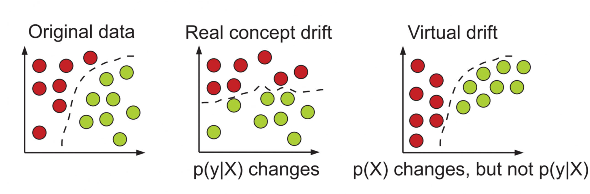

<!-- _class: title-slide -->

# Week 9
## Anomalie Detectie

---

<!-- _class: red-bg -->
# Outliers detecteren

---

## Outliers detecteren is belangrijk

- Outliers zijn vaak **belangrijker** dan courante zaken
- **Fraudedetectie**: ongewone transacties opsporen
- **Menselijke fouten**: vreemde meetwaarden herkennen
- **Data corruptie**: beschadigde data filteren
- **Procesverbetering**: datastroom achteraf verbeteren



> 💡 In heel wat problemen is het net de **uitschieter** die telt, niet het gemiddelde

---

## Soorten anomalieën

- Drie **soorten** anomalieën:
  - **Losse outliers**: de meest gekende vorm
  - **Plotse events**: beurscrashes, COVID, machinestoringen
  - **Data drift**: langzame verschuiving van het datagedrag



> Bv. meer mensen nemen de fiets, het patroon van weggebruikers verandert

---

## Historisch voorbeeld: tulpenbubbel

- Tijdens de **Gouden Eeuw** grote vraag naar tulpen in Nederland
- Tussen 1634 en 1637: **extreme prijsstijging**
- Op het hoogtepunt betaalde je voor **1 tulpenbol** het **10-jarig loon** van een vakman
- De eerste bekende **'bubbel'** op de beurs

 

---

## Bubbels komen nog altijd voor

- **.com crisis** rond 2000
- **Financiële crisis** 2007 (val van Lehman Brothers)
- Een ML-model kan de **omstandigheden** herkennen en beslissen om te (ver)kopen
- Beurskoersen voorspellen is **zéér moeilijk / onmogelijk**, uitzonderlijke omstandigheden vaststellen kan wel

---

<!-- _class: red-bg -->
# Niet-gesuperviseerde algoritmes

---

## Overzicht unsupervised

- **Isolation Forest**
- **Local Outlier Factor (LOF)**
- **Robust Covariance** (Elliptic Envelope)
- Je moet het **percentage outliers** (*contamination*) op voorhand kennen

> 📌 Hyperparameter tuning is bij unsupervised **niet mogelijk** (geen score om op te tunen)

---

## Isolation Forest - unsupervised

- Gebaseerd op een **random forest**-structuur
- Werkt **zeer algemeen**: geen voorwaarden over de verdeling

```python
from sklearn.ensemble import IsolationForest
clf = IsolationForest(contamination=0.05, random_state=42)
clf.fit(X)
y_pred = clf.predict(X)   # 1 = normaal, -1 = outlier
```

[DEMO] Notebook: `week09-anomaly-detection.ipynb`

---

## Isolation Forest: voor- en nadelen

**Voordelen**
- Zeer **efficiënt** en snel, ook voor grote datasets
- **Schaalbaar**: meerdimensionale data geen probleem
- **Simpel** in gebruik
- **Geen voorwaarden** over de verdeling van de data

**Nadelen**
- **Hyperparameter** `contamination` moet gekend zijn
- Werkt goed voor **geïsoleerde** gevallen, niet voor **groepjes**
- **Niet interpreteren** waarom een item als anomalie gelabeld is

---

## Local Outlier Factor (LOF) - unsupervised

- Kijkt naar de **lokale buren**
- Berekent een **lokale dichtheid**
- Punten met **lage dichtheid** worden als outlier aangeduid

```python
from sklearn.neighbors import LocalOutlierFactor
lof = LocalOutlierFactor(n_neighbors=20, contamination=0.05)
y_pred = lof.fit_predict(X)
```

[DEMO] Labo: `anomaly_detection_oefening.ipynb` (netwerkdata, 3D-plot + sliders)

---

## LOF: voor- en nadelen

**Voordelen**
- **Gevoelig** voor lokale anomalieën
- **Ongevoelig** voor ruis in de dataset
- **Interpretabel**: LOF-score per punt opvraagbaar

**Nadelen**
- **Niet** voor heel grote datasets (computationeel duur)
- **Gevoelig** voor hyperparameters (`n_neighbors`, `contamination`)
- **Multimodale data**: sommige modi worden als outlier gelabeld
- **Lokaal** karakter = ook het grote nadeel

---

## Robust Covariance (Elliptic Envelope) - unsupervised

- Werkt **enkel** voor **multinormaal verdeelde** datasets
- Gebruikt de **Mahalanobis-afstand** tot het centrum

```python
from sklearn.covariance import EllipticEnvelope
robust_cov = EllipticEnvelope(contamination=0.05)
robust_cov.fit(X)
y_pred = robust_cov.predict(X)
```

---

## Mahalanobis-afstand: visuele interpretatie

- Afstand uitgedrukt in **standaarddeviaties**, rekening houdend met meerdere dimensies
- Gemiddelde = **afstand 0**, hoe verder, hoe uitzonderlijker



```python
mahalanobis_distances = robust_cov.mahalanobis(X)
```

[DEMO] Notebook: `week09-anomaly-detection.ipynb`

---

## Robust Covariance: voor- en nadelen

**Voordelen**
- **Robuust** voor sterk gecontamineerde datasets
- **Visuele** interpretatie mogelijk
- **Tamelijk** goed schaalbaar

**Nadelen**
- Werkt enkel goed als data **normaal** verdeeld is
  - *Belangrijke, beperkende voorwaarde!*
- `contamination` moet ongeveer gekend zijn

> 💡 Hoe check je of data normaal verdeeld is? Met **statistische testen** (verder in deze les)


---

<!-- _class: red-bg -->
# Gesuperviseerd: One-Class SVM

---

## One-Class SVM - supervised

- **Classificatie** tussen normaal (1) en abnormaal (-1)
- Hyperparameter **`nu`** = verwacht percentage outliers
- Omdat data **gelabeld** is, kun je **GridSearch** doen

```python
from sklearn.svm import OneClassSVM
from sklearn.model_selection import GridSearchCV
from sklearn.metrics import make_scorer, f1_score

param_grid = {'nu': np.linspace(0.01, 0.5, 20)}
svm = OneClassSVM(kernel='rbf')
scorer = make_scorer(f1_score, pos_label=-1)
grid_search = GridSearchCV(svm, param_grid, cv=5, scoring=scorer)
grid_search.fit(X, y)
```

[DEMO] Notebook: `week09-anomaly-detection.ipynb`

---

## One-Class SVM: voor- en nadelen

**Voordelen**
- **Voor de hand liggend** als data gelabeld is
- **Zeer performant** (SVM is performant)
- **Geen eisen** qua vorm van de dataset

**Nadelen**
- Data moet **gelabeld** zijn

---

<!-- _class: red-bg -->
# Statistische testen

---

## Herhaling: p-waarde

- Een statistische test heeft altijd:
  - **Nullhypothese** $H_0$
  - **Alternatieve hypothese** (het tegengestelde van $H_0$)
- De test berekent een **teststatistiek** en een **p-waarde**
  - $p \ge 0.05$: de nullhypothese kan waar zijn
  - $p < 0.05$: té toevallig, verwerp $H_0$

> 💡 Je moet weten wat de nullhypothese is, het berekenen van de p-waarde doet een library

---

## Shapiro-Wilk: normaliteit voor 1 variabele

- Nullhypothese: **data komt uit een normale verdeling**

```python
from scipy.stats import shapiro

# Shapiro-Wilk test
statistic, p_value = shapiro(sample_data)
print("Shapiro-Wilk Statistic:", statistic)
print("P-value:", p_value)
```

---

## Anderson-Darling: normaliteit voor >1 variabele

- Nullhypothese: **data komt uit een (multi-)normale verdeling**

```python
from scipy.stats import anderson

result = anderson(sample_data_2d.flatten())
print("Anderson-Darling Statistic:", result.statistic)
print("Critical Values:", result.critical_values)
print("Significance Levels:", result.significance_level)
```

---

## Kolmogorov-Smirnov: 2 datasets vergelijken

- Nullhypothese: **twee samples komen uit dezelfde verdeling**

```python
from scipy.stats import ks_2samp

# Kolmogorov-Smirnov test
statistic, p_value = ks_2samp(sample1, sample2)
print("Kolmogorov-Smirnov Statistic:", statistic)
print("P-value:", p_value)
```


---

<!-- _class: red-bg -->
# Data Drift

---

## Data drift

- De **wereld** verandert elke dag, **data** dus ook
- Aannames van modellen zijn na verloop van tijd **niet meer geldig**
- Bv. IPv4: men dacht dat dit **meer dan voldoende** zou zijn voor alle IP-adressen



---

## Data drift monitoren

- **Summary statistics** van de data in het oog houden
- **Modelperformantie** in de gaten houden
- **Statistische tests** gebruiken



---

## Summary statistics

- Kijk over de tijd naar **gemiddelde**, **variantie** van inkomende data
- Kijk ook af en toe naar een **histogram**
- Deze tijdsreeks **automatisch** of **handmatig** controleren

> Zie oefenlabo: `data_drift_opgave.ipynb`

---

## Modelperformantie

- **Accuracy** van het model mag niet te veel dalen
- Ook de **confusion matrix** voor classificatie monitoren

---

## Statistische tests voor drift

- Check of nieuwe data uit **dezelfde verdeling** komt als oude data:
  - **Kullback-Leibler Divergence**
  - **K-Sample Anderson-Darling Test**

> 💡 Het idee is hetzelfde als bij de Kolmogorov-Smirnov-test: vergelijk twee samples

---

## Feature drift vs concept drift

- **Feature drift**: de **inputverdeling** $p(X)$ wijzigt
  - Bv. het klimaat in België wijzigt
  - De **decision boundary** blijft gelijk

- **Concept drift**: de **relatie** tussen input en output $p(y|X)$ wijzigt
  - Bv. nieuwe wetgeving wijzigt de labels



---

## Feature drift vs concept drift: voorbeeld

- **Model** getraind op 30 jaar weerdata in België (regenval)
- **Feature drift**: het **klimaat** wijzigt
  - Overstromingen Vesdervallei (2021)
  - Overstromingen Ijzerbekken (2023)
  - Droogte zomer 2018

- **Concept drift**: **Blue Deal** - we willen anders omspringen met regenval
  - Fundamentele wijziging in wat we van een regenmodel willen

 

---

## Concept drift detectie: ADWIN

- **ADWIN** (ADaptive WINdowing) algoritme
- Houdt statistieken bij in een **sliding window**

```python
from skmultiflow.drift_detection.adwin import ADWIN
adwin = ADWIN()

for i in range(2000):
    adwin.add_element(data_stream[i])
    if adwin.detected_change():
        print('Change detected at index:', i)
```

> Installatie: `pip install -U scikit-multiflow`

---

## Om af te sluiten

[LIVE DEMO] Wooclap-poll: https://app.wooclap.com/FECPKH

---

<!-- _class: red-bg -->
# Samenvatten

---

## Best practices (Week 9)

- Bij **unsupervised** anomaliedetectie: `contamination` op voorhand kennen
- Kies de detector op basis van je data: snel & groot → **Isolation Forest**, lokaal → **LOF**, normaal verdeeld → **Robust Covariance**
- **One-Class SVM**: hyperparameter tuning via GridSearch mogelijk
- Check verdelingsvoorwaarden eerst met **statistische tests** (Shapiro, Anderson-Darling, KS)
- Monitor **data drift** continu via summary statistics, modelperformantie en statistische tests
- **Feature drift** ≠ **concept drift**: input vs. relatie input-output

---

## Kernpunten

- **Isolation Forest = random forest**, **LOF = lokale dichtheid**
- **Robust Covariance = Mahalanobis-afstand**, enkel voor normale verdeling
- **One-Class SVM = supervised**, hyperparameter `nu`
- **Statistische tests** verwerpen $H_0$ of niet via p-waarde
- **Feature drift**: $p(X)$ wijzigt, **Concept drift**: $p(y|X)$ wijzigt
- ADWIN detecteert concept drift via sliding window

---

## Vragen?

